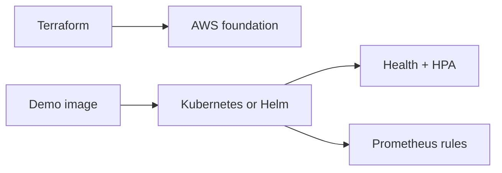

# PlatformKit

PlatformKit is a cloud-platform reference project that keeps its runnable local
service separate from examples that would provision or schedule infrastructure.
It combines an AWS Terraform foundation, plain Kubernetes manifests, a Helm
chart, horizontal autoscaling, health probes and Prometheus alert rules.



The release checks validate configuration and run the local HTTP service. They
do not authenticate to AWS, run `terraform plan` or `terraform apply`, create a
cluster, push an image, or deploy any resources.

## Requirements

- Python 3.11 or newer for the local demo and manifest tests
- Terraform 1.7 or newer
- Helm 3

The demo itself uses only the Python standard library. `requirements-dev.lock`
pins PyYAML for deterministic manifest tests. Terraform's provider selection
and checksums are recorded in `terraform/.terraform.lock.hcl`.

## Local setup and checks

```bash
python -m venv .venv
source .venv/bin/activate
python -m pip install -r requirements-dev.lock

make python-check
make demo
make helm-check
make fmt-check
make terraform-validate
```

`terraform init -backend=false` downloads the locked AWS provider but does not
configure remote state or contact an AWS account. `terraform validate` checks
the configuration without credentials. Do not run `terraform apply` unless you
have independently reviewed the resources, security model and likely AWS cost.

## Credential-free HTTP demo

```bash
python demo.py
```

The script starts `demo/app.py` on an available loopback port, verifies
`/health`, checks the Prometheus text exposed at `/metrics`, confirms unknown
paths return 404, and then stops the process. No container, cluster, cloud
account or credentials are required.

To run the service interactively:

```bash
HOST=127.0.0.1 PORT=8080 python demo/app.py
curl http://127.0.0.1:8080/health
curl http://127.0.0.1:8080/metrics
```

## Infrastructure contents

- `terraform/` — VPC, two public subnets, internet routing, an ECR repository
  with scan-on-push, and an ECS cluster with container insights.
- `k8s/base/` — a hardened demonstration Deployment and Service plus an HPA.
- `helm/platformkit/` — configurable packaging of the same service.
- `monitoring/` — example 5xx-rate and latency alert rules.
- `demo/` — a non-root container image and standard-library HTTP service.

## Scope and limitations

This is a portfolio/reference implementation, not a production landing zone.
It has no remote Terraform state, state locking, private subnets, NAT design,
IAM workload roles, encryption-key policy, Kubernetes cluster provisioning,
ingress, TLS, authentication, secrets integration, network policies, persistent
storage, log aggregation or deployment pipeline. The local service exposes toy
metrics rather than application traffic metrics, so the example alert rules
need real instrumentation before operational use. No AWS plan/apply, container
build, Kubernetes/Helm deployment, load test, hosted service or cloud cost was
performed as part of the release.

## Licence

MIT. See [LICENSE](LICENSE).
