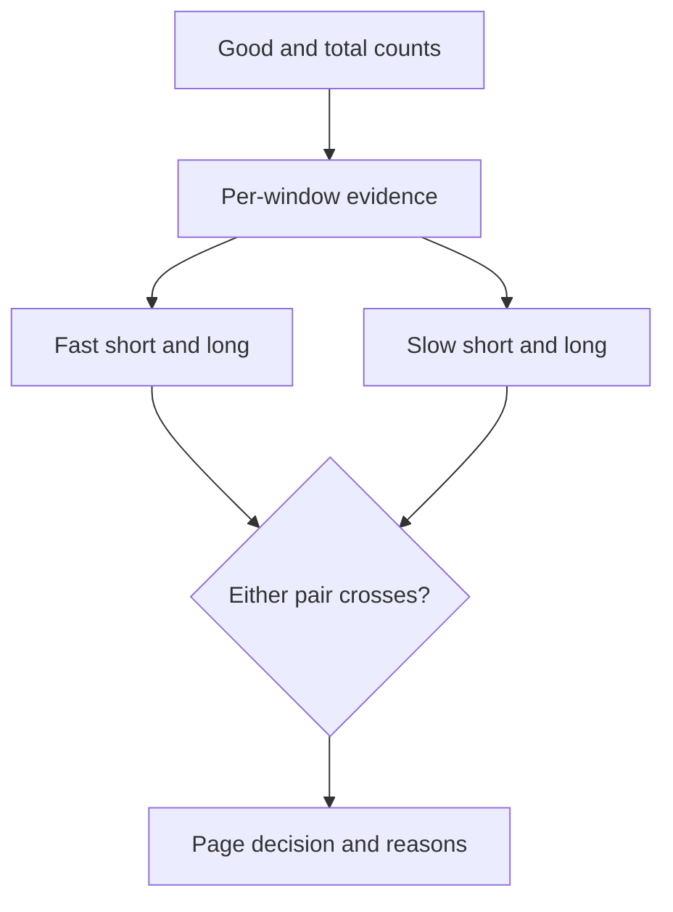

# SLOForge

SLOForge is a small SRE reference service that turns good/total request counts
into availability, error-budget, and burn-rate evidence. It evaluates two
independent window pairs: a fast pair for sharp incidents and a slower pair for
sustained degradation. A page is raised only when both windows in either pair
cross their shared threshold.

## What is included

- Framework-independent service-level objective and error-budget calculations.
- Inspectable evidence for every window: good, bad, total, availability, error
  ratio, and normalized burn rate.
- FastAPI validation for request counts, SLO targets, and alert thresholds.
- A credential-free demo that starts the actual HTTP server and exercises both
  a paging decision and invalid-input rejection.
- Prometheus recording and alert-rule examples for a fixed 99.9% API SLO.
- Focused domain, API, Prometheus-contract, lint, package-build, and CI checks.

## Requirements

- Python 3.11 or 3.12
- [`uv`](https://docs.astral.sh/uv/) for the locked development workflow

No cloud account, monitoring backend, API key, or paid service is required.

## Set up and verify

```bash
uv sync --frozen --extra dev
uv run ruff format --check .
uv run ruff check .
uv run pytest -q
uv build
```

Run the end-to-end HTTP demo:

```bash
uv run python demo.py
```

The demo selects a free loopback port, starts Uvicorn, checks health, submits
four observation windows, confirms a fast-burn page and burn-rate evidence, verifies
invalid counts are rejected, prints the observed decision, and shuts down.

## Run the API manually

```bash
uv run uvicorn sloforge.api:app --reload
curl http://127.0.0.1:8000/health
```

Example evaluation:

```bash
curl -X POST http://127.0.0.1:8000/v1/evaluate \
  -H 'Content-Type: application/json' \
  -d '{
    "target": 0.99,
    "fast_short": {"good": 80, "total": 100},
    "fast_long": {"good": 800, "total": 1000},
    "slow_short": {"good": 99, "total": 100},
    "slow_long": {"good": 990, "total": 1000}
  }'
```

The default fast and slow burn-rate thresholds are 14.4 and 6.0. They can be
overridden with positive `fast_threshold` and `slow_threshold` fields.
`remaining_error_budget` is calculated from the longest supplied window,
`slow_long`; it describes that observation set rather than a persisted
calendar budget.

## Decision model



For a target (T), the allowed error ratio is (1-T). For an observation
window:

[
\text{burn rate} =
\frac{\text{bad requests} / \text{total requests}}{1-T}
]

Zero-traffic windows are treated as fully available with zero burn and an
untouched budget. This is an explicit reference-policy choice, not a universal
monitoring rule.

## Prometheus reference

`prometheus/slo-rules.yml` records 5-minute, 30-minute, 1-hour, and 6-hour
error ratios, then pairs 5m/1h at 14.4x and 30m/6h at 6x. Those expressions
assume:

- a `http_requests_total` counter;
- `job="api"`;
- HTTP status in a `status` label;
- server errors matching `5..`; and
- a 99.9% SLO, represented by the hard-coded `0.001` error budget.

Adapt labels, the SLI definition, target, windows, and routing to the real
service before use.

## Limits and honest scope

- Input is caller-supplied aggregate data. There is no metrics ingestion,
  persistence, authentication, tenancy, notification delivery, alert routing,
  or incident lifecycle.
- The API does not verify that the four windows are chronologically aligned or
  nested. Production systems should derive them from one trusted metrics source.
- Prometheus YAML structure and expressions are contract-tested, but
  `promtool`, a running Prometheus server, and real metrics were not exercised
  locally.
- Docker is supplied as a packaging reference but was not built in the release
  environment. Load, scale, hosted deployment, and on-call outcomes were not
  tested.

## Licence and security

The project is MIT-licensed. See [SECURITY.md](SECURITY.md) before reporting a
security issue. This is a portfolio/reference implementation, not a production
monitoring service.

## Author

Lakshay Atreja
