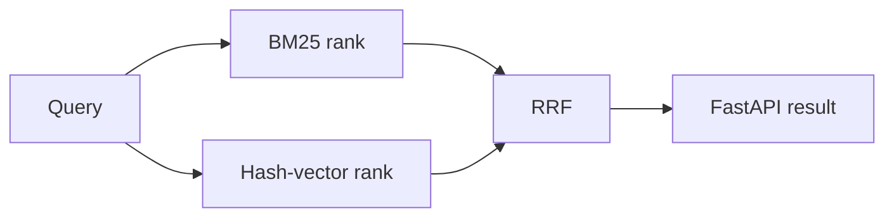

# SearchGrid

SearchGrid is a compact hybrid-retrieval reference service. It independently ranks
documents with BM25-style lexical scoring and deterministic signed hash vectors,
then combines the two ordered lists with Reciprocal Rank Fusion (RRF). The HTTP
response exposes each signal's rank so the result is inspectable rather than an
opaque aggregate score.

## What is included

- A framework-independent, in-memory `SearchIndex` with deterministic tie-breaking.
- FastAPI endpoints for health and bounded search requests.
- A credential-free demo that starts the real HTTP server and checks successful and
  invalid requests.
- PostgreSQL full-text, pgvector HNSW, and SQL RRF reference assets under `db/`.
- Focused unit, API, SQL-contract, formatting, lint, package-build, and CI checks.

## Requirements

- Python 3.11 or 3.12
- [`uv`](https://docs.astral.sh/uv/) for the locked development workflow

No API key, model download, database, or cloud account is needed for the runnable
demo.

## Set up and verify

```bash
uv sync --frozen --extra dev
uv run ruff format --check .
uv run ruff check .
uv run pytest -q
uv build
```

Run the reproducible end-to-end HTTP demo:

```bash
uv run python demo.py
```

The script chooses a free loopback port, starts Uvicorn, checks `/health`, confirms
the PostgreSQL/pgvector document ranks first for `PostgreSQL vector`, verifies a
validation failure, prints the observed result, and shuts the server down.

## Run the API manually

```bash
uv run uvicorn searchgrid.api:app --reload
curl 'http://127.0.0.1:8000/health'
curl 'http://127.0.0.1:8000/v1/search?q=PostgreSQL%20vector&k=2'
```

Each search result contains `rrf_score`, `lexical_rank`, and `vector_rank`. A null
individual rank means that retriever did not return the document; RRF can still rank
it using the other signal.

## Architecture



The SQL files show how the same pattern can be implemented with PostgreSQL generated
`tsvector` values, a GIN index, pgvector cosine distance, an HNSW index, and bounded
candidate lists. They are deployment references; the in-memory service does not
silently claim to use PostgreSQL.

## Docker reference

`docker compose up --build` starts the in-memory API and a pgvector-enabled
PostgreSQL instance. The containers are deliberately independent: wiring ingestion,
embedding generation, migrations, and the SQL query into the API is future work.

## Limits and honest scope

- The API contains four toy documents in memory. It has no persistence, ingestion,
  authentication, authorization, tenancy, or rate limiting.
- Hash vectors are deterministic token hashing—not learned embeddings, semantic AI,
  or a trained model. Collisions and lexical overlap constrain their usefulness.
- PostgreSQL and pgvector assets are statically checked but were not executed in the
  release environment. Docker, hosted deployment, load, scale, and performance were
  not tested.
- The demo uses only loopback HTTP and intentionally requires no purchased service.

## Licence and security

The project is MIT-licensed. See [SECURITY.md](SECURITY.md) before reporting a
security issue. This is a portfolio/reference implementation, not a production
service handling customer data.

## Author

Lakshay Atreja
