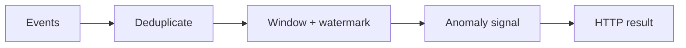

# StreamForge

StreamForge is a compact reference implementation of event-time stream
processing. It accepts telemetry events over HTTP, deduplicates event IDs,
maintains per-key windows, advances a watermark, rejects events beyond the
allowed-lateness boundary and evaluates new values against their recent
baseline.



The same engine is used by the HTTP API and the optional Kafka-compatible
consumer. The local demo and release checks require no broker, credentials or
paid service.

## Requirements

- Python 3.11 or 3.12
- [`uv`](https://docs.astral.sh/uv/) for the locked setup below

## Install

From this directory:

```bash
uv sync --frozen --extra dev
```

`uv.lock` records the complete resolved dependency graph. To resolve within the
declared compatibility ranges instead, omit `--frozen`.

## Run the API

```bash
uv run uvicorn streamforge.api:app --host 127.0.0.1 --port 8000
```

In another terminal:

```bash
curl http://127.0.0.1:8000/health
curl -X POST http://127.0.0.1:8000/v1/events \
  -H 'content-type: application/json' \
  -d '{"id":"event-1","key":"checkout-latency","value":124.5,"ts":1000}'
```

Interactive API documentation is available at `http://127.0.0.1:8000/docs`.

## Credential-free demo

The demo starts a real server on an available loopback port and exercises
health, stable-baseline ingestion, spike detection, duplicate rejection and
the too-late event policy:

```bash
uv run python demo.py
```

## Release checks

```bash
uv lock --check
uv run ruff check .
uv run ruff format --check .
uv run pytest -q
uv build
uv run python demo.py
```

## Optional Kafka-compatible worker

With a Kafka-compatible broker already running:

```bash
export KAFKA_BOOTSTRAP=localhost:9092
export KAFKA_TOPIC=telemetry.events
uv run python -m streamforge.consumer
```

The worker disables automatic commits and commits only after an event has been
decoded and processed. `docker-compose.yml` supplies a Redpanda development
topology, but broker and container integration are outside the credential-free
release gate.

## Scope and limitations

This is a single-process portfolio/reference implementation, not a production
streaming platform. State and deduplication IDs are held only in memory and are
lost on restart. There is no authentication, persistence, partition-aware
state, distributed coordination, schema registry, dead-letter queue, backfill
workflow, rate limiting or production telemetry. The anomaly detector is a
small per-key population-z-score rule, not a trained model. The release checks
do not run Redpanda, Docker, multi-partition recovery, load tests, a hosted
service or a cloud deployment.

## Licence

MIT. See [LICENSE](LICENSE).
