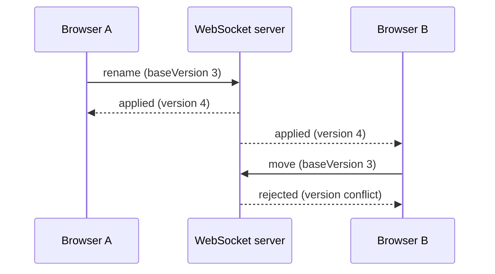

# SyncSpace

SyncSpace is a local real-time collaboration reference application built with TypeScript, React and WebSockets. Its shared task board uses per-card versions so a stale edit is rejected instead of silently overwriting a newer change.



## What it demonstrates

- A React task board served by the production Express process.
- WebSocket snapshots and fan-out to every connected browser.
- Versioned create, rename and move operations with stale-write rejection.
- Zod validation for untrusted WebSocket messages.
- Shared TypeScript domain types across server, client, tests and demo.
- A two-client integration test and a credential-free live WebSocket demo.

## Requirements

- Node.js 22 or newer.

## Install

Use the committed lockfile for a reproducible dependency installation:

```bash
npm ci
```

## Run the production build

```bash
npm run build
npm start
```

Open `http://localhost:8080` in two browser tabs. Add, rename or move a card in one tab and observe the other tab update. `PORT` can override the default port:

```bash
PORT=9000 npm start
```

The health endpoint is available at `http://localhost:8080/health`.

## Development mode

Run the WebSocket/API process and Vite client in separate terminals:

```bash
npm run server
npm run client
```

Vite runs on port 5173 and connects to the WebSocket server on port 8080.

## Automated live demo

The demo starts the real server on an available loopback port, connects two WebSocket clients, verifies that a new card reaches both clients, moves it and confirms that a stale rename is rejected. It needs no credentials or external service.

```bash
npm run demo
```

## Release checks

```bash
npm run typecheck
npm test
npm run build
npm run demo
```

## Scope and limitations

This is a portfolio/reference implementation, not a hosted production service. All cards are held in one process and are lost when it restarts. There is no authentication, authorization, persistence, multi-node coordination, rate limiting or production telemetry. The server accepts any browser that can reach it; do not expose it to the public internet without adding those controls. Optimistic concurrency is per card and does not provide offline merge or operational transformation. Docker configuration is supplied, but no container registry or cloud deployment is claimed.

## Licence

MIT. See [LICENSE](LICENSE).
